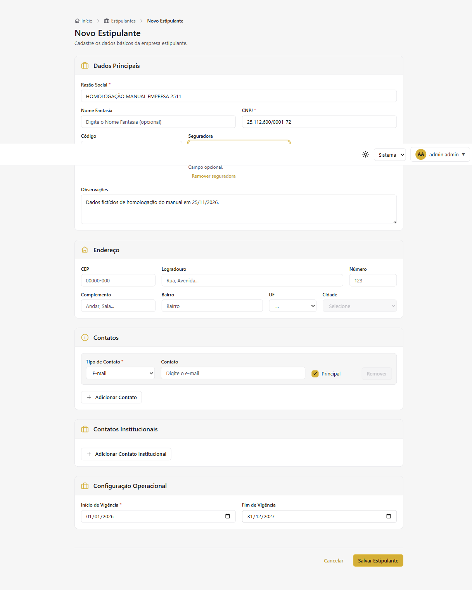
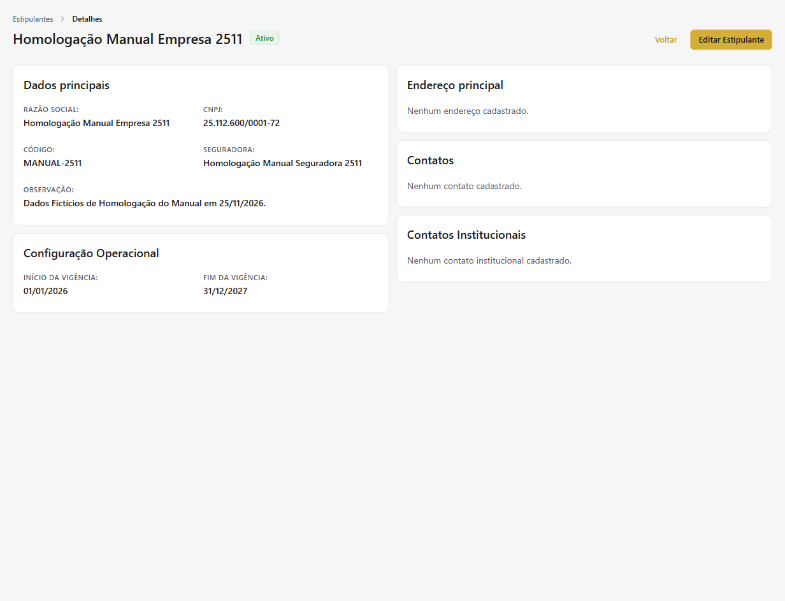
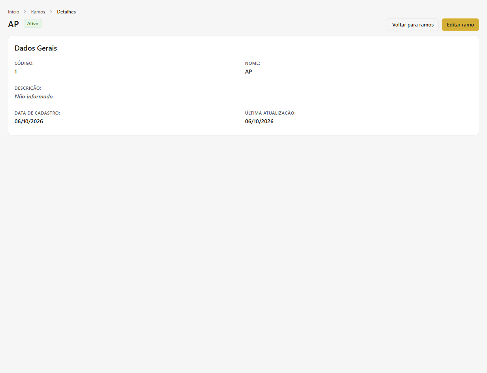

# Cadastros

[Início do manual](README.md) · [Anterior: conceitos](02-conceitos.md) · [Próximo: Apólices](04-apolices.md)

## Antes de Cadastrar

Pesquise o registro existente para evitar duplicidade. Confirme documento, nome e situação. Um registro inativo pode continuar necessário ao histórico; cadastrar outro com o mesmo significado não substitui a avaliação sobre editar ou reativar o existente.

Prepare os dados do cadastro e faça as seleções relacionadas. Campos obrigatórios e regras variam entre telas; siga os avisos apresentados. Nos formulários com várias seções, revise também os campos abaixo da área visível antes de salvar.

## Cadastrar um Cliente

**Onde:** Operação → Clientes.

1. Escolha a ação para cadastrar um novo Cliente.
2. Informe **Tipo de Pessoa**, **Documento (CPF/CNPJ)** e **Nome Completo / Razão Social**.
3. Preencha os demais dados aplicáveis, como data de nascimento, sexo e RE quando exibido.
4. Em **Contatos**, informe o tipo e o contato; identifique o principal quando necessário.
5. Em **Endereços**, preencha os dados e selecione UF e cidade conforme as opções.
6. Revise **Informações Adicionais** e observações. Marque falecimento/extinção apenas quando corresponder à situação real e confira a data aplicável.
7. Salve e confira o cadastro.

**Resultado esperado:** Cliente disponível para consulta. A matrícula e a participação em seguro são etapas posteriores.

Para editar, localize o Cliente e use a ação de edição autorizada. Confira o documento e o nome antes de alterar informações pessoais; não use a edição para transformar uma pessoa em outra.

## Criar ou Editar um Vínculo do Cliente

**Onde:** Operação → Clientes → detalhes do Cliente → Vínculos.

1. Confira o Cliente aberto.
2. Escolha adicionar um vínculo.
3. Selecione o **Estipulante** cadastrado. Percorra as páginas de opções se necessário.
4. Informe a **matrícula** e a situação oferecida no formulário.
5. Salve e confira o vínculo na lista.

Para alterar, abra a edição do vínculo existente. O sistema protege a identidade de vínculos já utilizados. Se houver bloqueio por histórico, não crie uma alteração artificial para contorná-lo; confira o uso em Apólices e Propostas com o responsável.

**Resultado esperado:** matrícula disponível no contexto cadastral. A identificação das Apólices aparece quando houver participação efetivamente associada em Vidas. Sem associação, siga [a inclusão de Vida](04-apolices.md#incluir-uma-vida).

## Consultar Propostas pela Matrícula

1. Nos detalhes do Cliente, encontre o vínculo correto.
2. Use **Propostas** na linha correspondente.
3. Confira Cliente, Estipulante e matrícula no contexto da janela.
4. Localize a proposta pela listagem ou pelo número.
5. Escolha explicitamente a versão desejada.

Um vínculo pode ter propostas de mais de uma Apólice e várias versões. A consulta não escolhe automaticamente uma proposta para você. As ações disponíveis no detalhe dependem das suas permissões e da situação daquela versão.

## Seguradoras e Corretoras

**Onde:** Parceiros e Estrutura → Seguradoras ou Corretoras.

1. Consulte se a organização já está cadastrada.
2. Abra o cadastro novo ou a edição do registro correto.
3. Preencha **Nome / Razão Social**, **CNPJ** quando aplicável e **Código Interno**.
4. Em Seguradoras, confira **Código SUSEP**; em Corretoras, confira **Código Protheus**. Preencha a observação quando necessária.
5. Salve e revise o resultado.

Escolher uma Seguradora em outro formulário exige que ela esteja disponível na consulta correspondente. Se não aparecer, confira o cadastro, a situação e seu acesso à consulta.

## Estipulantes

**Onde:** Parceiros e Estrutura → Estipulantes.

1. Pesquise por um registro existente e escolha cadastrar ou editar.
2. Revise **Razão Social**, **Nome Fantasia**, **CNPJ**, código e observações conforme aplicáveis.
3. No campo **Seguradora**, pesquise e selecione uma organização cadastrada quando houver vínculo a informar.
4. Preencha endereço, contatos e contatos institucionais necessários.
5. Em **Configuração Operacional**, informe **Início de Vigência**, que é obrigatório. Preencha **Fim de Vigência** quando aplicável.
6. Salve e abra os detalhes para conferir.

**Seguradora é opcional.** Para trocar, escolha outra opção e salve. Para desvincular, use **Remover seguradora** e salve. O vínculo pode ser mantido sem alteração quando você não tem acesso à pesquisa de Seguradoras.

O campo **Grupo** não faz parte do cadastro atual. Não é necessário preencher um substituto; eventuais vínculos antigos são preservados pelo sistema.

## Subestipulantes e Cooperados

**Onde:** Parceiros e Estrutura → área correspondente.

1. Consulte o registro para evitar duplicidade.
2. Abra a ação de cadastro ou edição.
3. Informe os dados de identificação e as relações exigidas pelo formulário.
4. Confira a situação e salve.

O cadastro de um Subestipulante não equivale ao seu vínculo com uma Apólice. Faça a associação no contexto da Apólice quando a rotina exigir. Da mesma forma, não presuma que cadastrar um Cooperado cria automaticamente Cliente, Vida ou Proposta.

| Cadastro | O que conferir no formulário |
| --- | --- |
| Subestipulante | Nome / Razão Social, CNPJ quando aplicável, Código Interno e Observações Internas |
| Cooperado — identificação | Tipo, Código, Nome, CPF, Data de Nascimento e Coordenador responsável quando aplicável |
| Cooperado — documentação | RG, Órgão Emissor, Data de Emissão e registros profissionais/fiscais apresentados |
| Cooperado — contato e endereço | Telefone, E-mail, CEP, logradouro, número, complemento, bairro, UF e cidade |
| Cooperado — operação | Número de Dependentes, Data de Inscrição e indicação de Cooperado Credenciado |
| Cooperado — banco | Banco, Agência e Conta Corrente, além das observações pertinentes |

O número de dependentes do Cooperado é uma informação cadastral. Não deve ser interpretado como inclusão automática de beneficiários ou dependentes em uma Proposta.

## Ramos

**Onde:** Configurações do Seguro → Ramos.

Para cadastrar, abra a inclusão, informe **Código** e **Nome**, preencha a **Descrição** quando necessária e salve. Para consultar um existente:

1. Consulte o Ramo desejado.
2. Use **Visualizar** para abrir seus detalhes.
3. Confira nome, situação, código quando apresentado, descrição e datas.
4. Se precisar corrigir e possuir acesso, use a edição disponível.

O Ramo participa da configuração do seguro e da conferência financeira. Mudanças cadastrais não recalculam automaticamente valores financeiros já confirmados.

## Coberturas

**Onde:** Configurações do Seguro → Coberturas.

1. Cadastre ou localize a Cobertura.
2. Revise nome, nome reduzido, classificação básica e reajuste, conforme exibidos.
3. Salve o cadastro compartilhado.
4. Para informar os prêmios de uma Apólice, abra o [Plano do Módulo daquela Apólice](04-apolices.md#configurar-plano-e-coberturas).

Alterar os atributos da Cobertura afeta a identificação compartilhada nos vínculos. Os prêmios de titular e cônjuge pertencem à associação com o Plano e são mantidos separadamente.

## Módulos Globais

**Onde:** Configurações do Seguro → Módulos Globais.

Consulte, cadastre ou edite o Módulo conforme sua autorização. Confira **Nome do Módulo**, **Descrição** e **Status** quando apresentado. Depois, faça o vínculo no contexto da Apólice e configure seu Plano e suas Coberturas. O cadastro global é uma referência reutilizável; sozinho não conclui a preparação da Apólice.

## Convênios de Cobrança

**Onde:** Configurações do Seguro → Convênios de Cobrança.

O formulário reúne dados gerais e bancários, configurações de arquivos de remessa/retorno e dados do estabelecimento. Preencha somente informações validadas pelo responsável por esse cadastro e confira códigos, agência, conta e caminhos quando aplicáveis.

**Limite:** a existência desses campos não significa que a rotina atual emite boletos, transmite arquivos ou realiza liquidação bancária. As operações financeiras disponíveis estão no [capítulo Financeiro](06-financeiro.md).

## Conferência Após Salvar

- Confirme que o nome e o documento identificam a pessoa ou organização correta.
- Reabra o registro e confira contatos, endereço e relações importantes.
- Verifique se a situação permite o uso desejado na etapa seguinte.
- Ao usar uma lista de seleção já aberta em outra tela, recarregue suas opções quando necessário.
